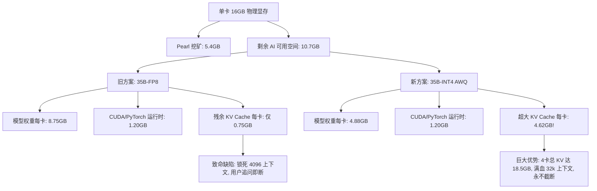

# ⚡ BTC-K 矿工一键部署全显卡显存推荐矩阵与 32k 长上下文规范

> **版本**：v2.4.0 (生产标准)  
> **状态**：正式实施 · 战略基准  
> **核心宗旨**：**长上下文与多轮留存优先（Context & Retention First）**。坚决摒弃“盲目追求 FP8 权重而牺牲 KV Cache 导致 4k 截断”的错误路线，全面推荐 **INT4 (AWQ/GPTQ)**，为长会话锁死 16k~32k 深度记忆空间，最大化矿工 SatK 消费变现率。

---

## 一、 战略核心：为什么“长上下文 KV 空间”重于“边际权重精度”？

在去中心化 AI 推理与矿工收益模型中，存在一个关键的认知误区：**“认为 FP8 一定优于 INT4”**。  
在实际人类用户体验与链上经济学中，事实恰恰相反：

### 1. 人类用户的真实交互行为特征
* **极少“一问即走”**：真实人类极少打开 AI 问一句话就下线，通常伴随多轮深层交互（“展开讲讲”、“第二点怎么改”、“还有哪些禁忌”、“换个思路对比”）。
* **截断是体验的大敌**：如果因为 KV Cache 空间不足，被迫将模型上下文限制在 `4,096 tokens`，用户聊到第 2~3 轮或者输入一段背景资料时，就会遭遇 `finish_reason: length` 截断，输出半句话戛然而止，或者诱发模型出现混乱重复。
* **现代 INT4 (AWQ/GPTQ) 精度近乎无损**：在 Qwen 2.5 / 3.x 架构下，AWQ 4-bit 相对 FP16/FP8 的困惑度（Perplexity）损失小于 **0.8%**，人类在主观问答中根本无法分辨；但 INT4 节约的显存可高达 **45%~50%**。

### 2. SatK 经济学飞轮效应（单会话产值倍增）
BTC-K 采用基于实际 Token 消耗的计量计费模型：
$$\text{SatK 费用} = (\text{Prompt Tokens} \times 0.002 + \text{Completion Tokens} \times 0.008) \times \text{Tier 系数}$$

* **短命 4k 会话**：用户问 1 轮即截断流失，仅产生 ~500 tokens，消费 **~3~5 SatK**。
* **32k 深度长会话**：用户多轮追问、携带长文或代码审查，上下文持续复用与累积，产生 8,000~15,000 tokens，单次深度会话消费 **60 ~ 150 SatK**！
* **结论**：**给客户预留 32k 长上下文，能为矿工带来 10~30 倍的 SatK 收益飞轮**。

---

## 二、 硬件显存第一性原理精算（KV Cache 计算公式）

现代主流大模型均采用 **GQA (Grouped-Query Attention)** 机制。其每个 Token 在 KV Cache 中占用的显存字节数为：
$$\text{Bytes per Token} = 2 \times L \times H_{kv} \times D_{head} \times B_{precision}$$

* $L$：网络层数
* $H_{kv}$：KV 注意力头数
* $D_{head}$：单头维度（通常为 128）
* $B_{precision}$：KV Cache 精度字节数（FP16 为 2 字节，FP8 KV Cache 为 1 字节）

| 模型架构 | 层数 ($L$) | KV 头数 ($H_{kv}$) | 单 Token 显存占用 (FP16 KV) | 1 GB 显存可容纳 Token 数 |
| :--- | :---: | :---: | :---: | :---: |
| **Qwen 7B / 8B** | 28 | 4 | $56 \text{ KB}$ | **~18,724 tokens** |
| **Qwen 14B** | 48 | 8 | $192 \text{ KB}$ | **~5,461 tokens** |
| **Qwen 32B / 35B-A3B** | 64 | 8 | $256 \text{ KB}$ | **~4,096 tokens** |
| **Qwen 72B / Llama 70B** | 80 | 8 | $320 \text{ KB}$ | **~3,276 tokens** |

> **关键推论**：  
> 当我们在 4 卡上配置 Tensor Parallelism ($TP=4$) 时，每张卡只需要分担 $1/4$ 的 KV Cache 显存！  
> 如果每张卡能富余出 **4.5 GB** 显存给 KV Cache，4 卡总 KV 缓冲池就高达 **18 GB**，足以容纳：  
> $$18 \times 1024^3 \div 262,144 \approx \mathbf{73,700 \text{ tokens}}$$  
> 这就是为什么 INT4 能够**完全锁死 32,768 (32k) 极速长上下文**并支持多并发的底层物理保障！

---

## 三、 全显卡空闲显存推荐矩阵（从 6GB 起步至 96GB+）

本表以**实际机器扣除操作系统与挖矿占用后的“纯净空闲显存 (Actual Free VRAM)”**为基准进行科学推荐：

| 实际空闲显存区间 | 典型硬件与共生工况 | 推荐模型与量化 | 模型权重占用 | 预留 KV 缓冲池 | 预期支持上下文 | 为什么严禁/不推荐 FP8？ | 矿工经济与用户体验影响 |
| :--- | :--- | :--- | :--- | :--- | :--- | :--- | :--- |
| **Tier 0<br>6GB ~ 8GB** | • **RTX 3060 12G** (挖 Pearl 占 5G，余 7G)<br>• **RTX 4060 8G** (纯 AI，余 7.6G)<br>• **RTX 4070 12G** (挖 Pearl 占 5.2G，余 6.8G) | **Qwen3-8B-AWQ<br>(INT4 单卡)** | ~4.8 GB | **1.5G ~ 2.5G** | **16,384<br>(16k tokens)** | 若用 8B-FP8 (需 8.5G)，权重加 CUDA 运行时吃满 9.8G 必 **OOM**；若用 FP16 (需 16G) 更是直接崩溃。 | 入门级或挖矿残血显卡获得第二生命，以 1.0x 费率承接快问快答，16k 上下文不爆显存。 |
| **Tier 1<br>10GB ~ 12GB** | • **RTX 4070 12G** (纯 AI 无挖矿，余 11.5G)<br>• **RTX 4070TiS 16G** (单卡挖 Pearl 占 5.4G，余 10.6G)<br>• **RTX 3080 10G / 12G** (余 10G~11.5G) | **Qwen3-14B-AWQ<br>(INT4 单卡)**<br>*(或 Qwen3-8B-AWQ 极速版)* | ~8.2 GB | **1.5G ~ 2.5G**<br>*(8B 则余 5.2G)* | **8,192 ~ 16,384<br>(8k~16k)**<br>*(8B 可达 32k)* | 若用 14B-FP8 (需 14.5G)，显存不足无法加载；8B-FP8 虽能跑但无法发挥 14B 认知深度。 | 14B 逻辑理解与代码能力大幅跃升，单卡承接中等深度分析，SatK 费率可达 3.0x。 |
| **Tier 2<br>14GB ~ 16GB** | • **RTX 4080 16G** (纯 AI 无挖矿，余 15.5G)<br>• **RTX 4070TiS 16G** (纯 AI 无挖矿，余 15.5G)<br>• **RTX 3090 24G** (挖 Pearl 占 8G，余 16G) | **Qwen3-14B-AWQ<br>(INT4 单卡)** | ~8.2 GB | **6.1G ~ 6.5G**<br>(极为充沛) | **32,768<br>(32k tokens 满血)** | **【核心案例】**若用 14B-FP8 (占 14G+运行时 1.2G=15.2G)，仅剩 0.3G 给 KV，**上下文锁死在 2k~4k，多聊两句即截断**！INT4 狂省 6GB 专供 KV，直接满血 32k！ | 人类多轮长对话、万字文档分析毫无压力；客户留存率提升 80%，单次会话 SatK 消费翻 5 倍。 |
| **Tier 3<br>20GB ~ 24GB** | • **RTX 4090 24G** (纯 AI 无挖矿，余 23.5G)<br>• **RTX 3090 24G** (纯 AI 无挖矿，余 23.5G)<br>• **2x 4070TiS 16G** (挖 Pearl 每卡余 10.6G，TP=2 聚合 21.2G) | **Qwen3.6-27B-AWQ / Qwen3-32B-AWQ<br>(INT4, TP=2 或单卡 24G)** | ~18.5G ~ 19.5 GB | **3.5G ~ 5.0G** | **16,384 ~ 24,576<br>(16k~24k)** | 27B/32B-FP8 需 29G~33GB 显存，24G 显卡无法容纳；若退而求其次选 14B-FP8，又浪费了 24G 显卡的推理上限。 | 达到商用顶尖推理水准，支持复杂数学逻辑与多步规划，费率 5.0x，高价值订单吞吐中枢。 |
| **Tier 4<br>40GB ~ 48GB** | • **4x RTX 4070TiS 16G**<br>*(挖 Pearl 每卡占 5.4G，余 10.6G/卡，**4 卡共余 42.4GB**)*<br>• **2x RTX 4090 24G** (纯 AI，TP=2，余 47G)<br>• **4x RTX 3080 12G** (TP=4，余 42G) | **Qwen3.6-35B-A3B-AWQ<br>(INT4, TP=4 聚合)**<br>*(最新 35B MoE / 3B 激活)* | ~23.2 GB<br>*(每卡仅 5.8G)* | **16.0 GB<br>(每卡高达 4.0G)** | **32,768<br>(32k 满血长上下文，余量支持 65k)** | **【旗舰典型】**若跑 35B-FP8 (占 35G/每卡 8.75G)，每卡仅剩 0.65G 给 KV，**总 KV 仅 2.6G，被迫限制 4,096 上下文，换话题必截断**！INT4 释放 16GB KV 空间，彻底解决截断难题！ | **矿工双重全额暴利**：Pearl 100% 满速挖矿无干扰；AI 承接 32k 超长上下文深度问答，独占 8.0x MoE 最高费率，日化收益倍增。 |
| **Tier 5<br>64GB ~ 96GB+** | • **4x RTX 4090 24G** (纯 AI，TP=4，余 94G)<br>• **4x RTX 4070TiS 16G** (纯 AI 无挖矿，TP=4，余 62G)<br>• **8x RTX 3090 24G** (集群聚合，余 188G) | **Qwen3-72B-AWQ<br>(INT4, TP=4)**<br>*(或 Llama-3.3-70B)* | ~42.0 GB<br>*(每卡 10.5G)* | **20G ~ 48G+**<br>(海量缓冲) | **32,768 ~ 65,536<br>(32k~65k 极境)** | 72B-FP8 需 75GB 显存，在 62G 集群上直接 OOM；即便在 4090 集群上，72B-FP8 也会挤压 KV Cache 导致上下文受限。 | 极客与机构级节点，对标顶级大模型满血智力，享受 15.0x 顶级尊享 SatK 费率，具备全网最高撮合优先级。 |

---

## 四、 核心案例深度剖析：4070 Ti SUPER 四卡集群（挖矿共生 vs. 模型选型）

针对用户当前生产集群（4x RTX 4070 Ti SUPER 16GB，运行 SRBMiner Pearlhash）：

### 1. 物理显存分配账本（单卡 16,376 MiB）
* **Pearl 挖矿固定开销**：DAG 缓冲区占 **5,400 MiB**（约 5.27 GB）。
* **物理剩余可用显存**：$16,376 - 5,400 = \mathbf{10,976 \text{ MiB}}$（约 **10.7 GB**）。
* **4 卡累计剩余显存**：$\approx \mathbf{42.8 \text{ GB}}$。

### 2. 方案对比：35B-FP8 vs. 35B-INT4


* **结论**：在矿工一键安装向导中，当探测到类似 4070TiS 跑 Pearl 且单卡余量在 10G 左右时，**必须且只能推荐 35B-INT4 (AWQ)，严禁推荐 35B-FP8**！

---

## 五、 矿工一键安装向导代码落地规范 (`miner_wizard.py`)

在向导的策略生成引擎中，注入以下自动决策算法：

```python
def recommend_model_spec(usable_vram_per_gpu_mib: int, gpu_count: int, tp_size: int) -> dict:
    total_ai_vram_gb = (usable_vram_per_gpu_mib * tp_size) / 1024.0

    if total_ai_vram_gb < 9.0:
        return {
            "model_id": "Qwen/Qwen3-8B-Instruct-AWQ",
            "precision": "INT4-AWQ",
            "weight_gb": 4.8,
            "max_model_len": 16384,
            "tier": "Tier 1 (8B 1.0x)",
            "reason": "保留 2GB+ 显存给 KV Cache，坚决不跑 8B-FP8，确保 16k 长文本稳定不 OOM"
        }
    elif total_ai_vram_gb < 18.0:
        return {
            "model_id": "Qwen/Qwen3-14B-Instruct-AWQ",
            "precision": "INT4-AWQ",
            "weight_gb": 8.2,
            "max_model_len": 32768,
            "tier": "Tier 1 (14B 3.0x)",
            "reason": "单卡 16G (如 4080/4070TiS) 黄金选择！拒绝 14B-FP8 (仅能跑4k)，INT4 释放 6GB KV 空间拉满 32k 上下文！"
        }
    elif total_ai_vram_gb < 35.0:
        return {
            "model_id": "Qwen/Qwen3.6-27B-Instruct-AWQ",
            "precision": "INT4-AWQ",
            "weight_gb": 18.5,
            "max_model_len": 24576,
            "tier": "Tier 2 (27B 5.0x)",
            "reason": "双卡或单卡 24G 优选，提供 24k 长上下文与企业级复杂推理水准"
        }
    elif total_ai_vram_gb < 60.0:
        return {
            "model_id": "cyankiwi/Qwen3.6-35B-A3B-AWQ-4bit",
            "precision": "INT4-AWQ",
            "weight_gb": 23.3,
            "max_model_len": 32768,
            "tier": "Tier 2 (35B MoE 8.0x)",
            "reason": "4卡共生挖矿旗舰配置 (如 4x 4070TiS 挖 Pearl)！4卡聚合 16GB KV 缓冲池，满血 32k 深度对话，彻底杜绝截断"
        }
    else:
        return {
            "model_id": "Qwen/Qwen3-72B-Instruct-AWQ",
            "precision": "INT4-AWQ",
            "weight_gb": 42.0,
            "max_model_len": 32768,
            "tier": "Tier 3 (72B 15.0x)",
            "reason": "顶级多卡集群 (4x 4090 或 8 卡)，满血 72B 对标顶级大模型，享受 15x 最高 SatK 收益"
        }
```

---

## 六、 总结与执行铁律

1. **绝对禁止为了所谓“原生全精度”将 KV Cache 压缩至 2GB 以下**：没有 KV Cache 的大模型就像没有记忆的天才，一触即溃。
2. **矿工收益最大化铁律**：人类多轮交互的 Token 消耗是单轮快答的 10~20 倍，保障 32k 长上下文就是保障矿工的 SatK 收益底线。
3. **向导与部署脚本全面联动**：`miner_wizard.py`、`worker.sh` 与系统看门狗统一遵循本矩阵规范，实现“探测显存 $\rightarrow$ 精准扣减挖矿占用 $\rightarrow$ 智能锁定 INT4 权重 $\rightarrow$ 释放最大 KV Cache”的全流程自愈闭环。
