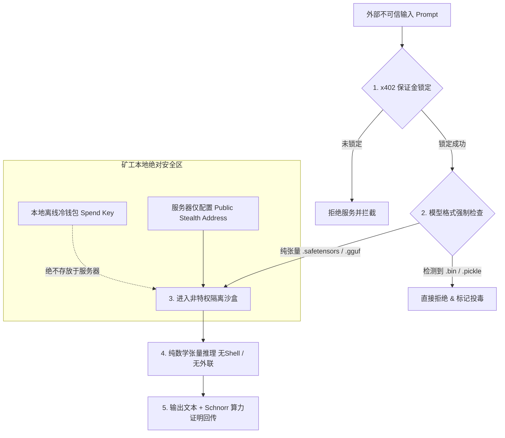

# BTC-K GPU 算力共生与分级 AI 网格战略规范
**Document ID: BTCK-SPEC-GPU-AI-01**  
**Version: v1.0.0-Canonical**  
**Status: APPROVED & RATIFIED FOR IMPLEMENTATION**  
**Author: BTC-K Core Architecture & Tokenomics Working Group**  
**Date: 2026-09-16**

---

## 目录
1. [战略背景与核心定位：打破 DePIN 冷启动死穴](#1-战略背景与核心定位打破-depin-冷启动死穴)
2. [硬件与模型全谱系分级矩阵（Tier 0 ~ Tier 4）](#2-硬件与模型全谱系分级矩阵tier-0--tier-4)
3. [动态经济学模型与版本自进化机制](#3-动态经济学模型与版本自进化机制)
4. [越狱/去对齐模型（Uncensored）暗流高价通道](#4-越狱去对齐模型uncensored暗流高价通道)
5. [核反应堆级五道安全防护体系（Zero-Trust Defense）](#5-核反应堆级五道安全防护体系zero-trust-defense)
6. [企业级/高校 H100 算力中心特洛伊木马战略](#6-企业级高校-h100-算力中心特洛伊木马战略)
7. [矿工极致「一键部署包」产品形态设计](#7-矿工极致一键部署包产品形态设计)
8. [分阶段落地实施工作计划（Actionable Roadmap）](#8-分阶段落地实施工作计划actionable-roadmap)

---

## 1. 战略背景与核心定位：打破 DePIN 冷启动死穴

### 1.1 行业最大痛点：算力空转烧电
传统去中心化算力网络（Akash、io.net、Render 等）普遍陷入恶性循环：
- **没有真实订单时**：矿工昂贵的显卡被迫开机空转或待机，电费与折旧白白流失，矿工纷纷离场；
- **有偶发订单时**：矿工早已关机，导致网络响应延迟极高、SLA 崩溃。

### 1.2 BTC-K 破局方案：算力共生（Symbiosis）而非零和博弈
借力当前已具备坚挺买盘、真实代币经济的成熟 GPU 挖矿币种（以近期币价从 $0.2 飙升至 $0.6 的 **Pearl / PRL** 为首发基石）：
1. **常态 100% 挖矿（保底收益）**：显卡平时以全速满载进行 PoW 算法哈希计算（如 `pearlhash`），为矿工提供稳定的现金流；
2. **毫秒抢占执行 AI（暴击收益）**：一旦 BTC-K 的 x402 AI-RPC 网关有高价推理订单进入，调度器在毫秒级内冻结挖矿线程，让出显卡张量核心执行大模型生成，赚取 **3x ~ 8x 于传统挖矿的高额 SatK 报酬**；
3. **任务结束秒级复原**：无外部任务时，显卡瞬间恢复满速挖矿，零算力损耗，零显存重载。

### 1.3 核心资产定性：彻底打破空气币属性
BTC-K 原生为 Kaspa 架构的 ASIC（kHeavyHash）抗量子 BlockDAG，不与 GPU 争夺底层出块算力；但在上层应用生态中，**BTC-K 代币是整个全球 GPU 算力消费、推理与具身智能体互动的唯一强刚需结算媒介**，代币具备物理算力与真实电力的强价值锚定。

---

## 2. 硬件与模型全谱系分级矩阵（Tier 0 ~ Tier 4）

为了吸纳全网从千元级消费卡到千万级超算集群的全部闲置算力，彻底打破“起步卡死在 12G/16G”的狭隘限制，建立如下五级算力矩阵：

| 等级 (Tier) | 显存门槛 | 代表显卡硬件 | 承载模型规模与量化类型 | 典型 Agent 任务场景 | 挖矿共生与工作模式 |
| :--- | :--- | :--- | :--- | :--- | :--- |
| **Tier 0: 微型边缘级** | **6GB ~ 8GB** | RTX 2060, 3060 8G, 4060, Apple M系列 (8G/16G) | **1.5B ~ 3B 极速小模型**<br>*(Qwen-2.5-1.5B/3B, Llama-3.2-3B)*<br>**+ 向量嵌入/重排 (BGE-M3, Reranker)** | 语义检索向量化、意图识别路由、格式化 JSON 提取、语法修正 | **双模共生**：Pearl 占 4.8G，剩余 2G~3G 常驻 1.5B 模型或 Embedding，兼顾高频打杂任务 |
| **Tier 1: 标准交互级** | **12GB ~ 16GB** | RTX 3080, 4070, 4070Ti, 4070Ti Super | **7B ~ 8B**<br>*(DeepSeek-R1-8B, Llama-3.1-8B Q4)* | 日常复杂对话、多轮问答、初级逻辑推理、情感陪伴 | **双模共生标杆**：Pearl 占 4.8G，剩余 11.2G 常驻 8B 量化模型（~5.5G），零延迟热切换 |
| **Tier 2: 深度推理级** | **24GB ~ 32GB** | RTX 3090, 4090, 双卡 4070Ti 机架 | **14B ~ 32B**<br>*(Qwen-2.5-32B, DeepSeek-32B Q4)* | 生产力中枢：长文本深度论证、多步骤 Agent 工作流、技术文档解析 | **主力中坚**：单卡 4090 优先接高价 32B 订单，空闲时切回挖矿 |
| **Tier 3: 旗舰专家级** | **48GB ~ 96GB** | 4卡 4090/4070Ti 机架, 双卡 A100 | **70B ~ 72B**<br>*(Qwen-2.5-72B, Llama-3.3-70B)* | 高端智囊：复杂全栈代码编写、智能合约漏洞审计、重大战策决策推演 | **高溢价专用**：支持多卡张量并行 (Tensor Parallelism)，单次计费极高 |
| **Tier 4: 超级集群级** | **320GB ~ 640GB+** | 8x H100 / H800 / H200 算力中心集群 | **405B ~ 671B 满血 MoE**<br>*(DeepSeek-V3/R1 满血版)* | 世界模型模拟、多模态多智能体联合脑、前沿科学攻坚 | **企业暗流托管**：对接大厂/实验室闲置资源，全额享受顶格 SatK 分红 |

---

## 3. 动态经济学模型与版本自进化机制

### 3.1 结算价格梯度计算公式
算力调用单价严禁一口价，必须通过公式由模型规模、版本新鲜度及特殊属性联合决定：

$$\text{Final Price (SatK)} = \text{Base Price} \times \text{Tier Multiplier} \times \text{Variant Multiplier} \times \text{Age Decay Factor}$$

- **Base Price（基准单价）**：当前协议基础定价（如 10 SatK / 1,000 Tokens）；
- **Tier Multiplier（层级系数）**：
  - Tier 0 (1.5B~3B / Embedding): **0.4x ~ 0.6x**
  - Tier 1 (7B~8B): **1.0x (基准)**
  - Tier 2 (14B~32B): **4.0x ~ 6.0x**
  - Tier 3 (70B~72B): **15.0x ~ 20.0x**
  - Tier 4 (405B~671B): **50.0x+**
- **Variant Multiplier（变体通道系数）**：
  - 官方对齐标准模型（Standard Aligned）：**1.0x**
  - 越狱/去对齐模型（Uncensored / Abliterated）：**3.0x ~ 5.0x（暴利暗流溢价）**
- **Age Decay Factor（版本新鲜度衰减系数）**：
  - 当前最新旗舰版本（如 Qwen 3.5）：**1.0x**
  - 下一代发布后，旧版本进入 30 天平滑衰减，最终降至 **0.3x**。

### 3.2 破解矿工偷懒不升级：市场需求自发淘汰（Demand-Driven Selection）
1. **订单定向撮合**：调用方 Agent 在请求头明确指定模型标识（`X-Model-Requested: qwen-3.5-32b`）；
2. **订单分发隔离**：本地停留在旧版本（如 Qwen 2.5）的矿工根本收不到新订单，面临订单饥渴；
3. **利润倒逼升级**：新版模型单量充沛且享有 1.0x 满额单价，旧版收益腰斩。矿工出于纯粹的逐利本能，会在 24 小时内自发完成权重更新。

### 3.3 去中心化模型目录治理（CIP 规范）
- **自动对标（Auto-Oracle）**：网关内置预言机，追踪 HuggingFace 与 OpenRouter 每月调用量 Top 20 榜单；
- **权重哈希固化**：入选白名单的模型必须在协议参数中固化其 SHA-256 校验和与 GGUF/Safetensors 官方源，杜绝恶意篡改。

---

## 4. 越狱/去对齐模型（Uncensored）暗流高价通道

### 4.1 商业定位：全网唯一抗审查高阶推理网络
- **行业禁区**：OpenAI、Anthropic、Google 等中心化巨头受欧美法规与合规道德限制，拒绝回答黑客安全攻防、渗透测试脚本、去掩码金融审计及争议性创作；
- **BTC-K 护城河**：借助 **零 KYC（HTTP 402）** 与 **Monero 级 Stealth 隐形钱包**，打造全球无法追踪、不可封禁、100% 遵从指令的极客去对齐（Abliterated）模型专用推理通道；
- **暴利定价**：极客与机构用户愿为“绝不说‘我很抱歉，我无法回答’”的完全遵从性支付 **3~5 倍高额溢价**。

---

## 5. 核反应堆级五道安全防护体系（Zero-Trust Defense）

接入高自由度的越狱模型，必须实行严格的物理级零信任安全架构，杜绝反噬主链或矿工：



### 5.1 第一道防线：矿工资产物理隔离（Zero-Key 原则）
- **绝不存放私钥**：GPU 矿机服务器上**仅配置一个只收钱的公开 Stealth 隐形接收地址**，绝对严禁存放 Spend 提现私钥；
- **攻击清零**：即使操作系统遭遇最高级别 0-Day 攻陷，黑客在机器上也搜寻不到一分钱资产。

### 5.2 第二道防线：模型格式死锁（防权重投毒）
- **死锁格式**：协议层硬编码拦截所有可执行格式（`.pickle`、`.pt`、`.bin`、`.pkl`）；
- **仅准入纯张量**：只允许加载 **`.safetensors`**（HuggingFace 安全标准）和 **`.gguf`**（llama.cpp 纯二进制矩阵），物理杜绝反序列化木马与任意代码执行。

### 5.3 第三道防线：纯文本沙盒（断壳、断网、无特权）
- **无 Shell 权限**：推理引擎以低权限独立系统用户（`nobody` / `btck-sandbox`）在 Docker/cgroup 沙箱中运行，剥离一切命令执行能力；
- **网络外联锁（Egress Lock）**：断绝容器对外的互联网访问通道，仅保留与本地调度器的标准 UNIX Socket，模型输出的恶意代码绝对无法对外发射。

### 5.4 第四道防线：金融与资源防洪堤（防 OOM 炸弹与 DoS）
- **x402 预支付抵押**：所有请求必须先完成 SatK 签名锁定，攻击者发送 10 万次恶意垃圾请求即等同于向矿工和全网币价“真金白银巨额送钱”；
- **上下文硬截断**：单次推理硬限制（如 4,096 Tokens），超长上下文在进入 GPU 显存前直接被网关安全丢弃。

### 5.5 第五道防线：共识层的数学免疫
BTC-K 的 BlockDAG 出块逻辑与 Schnorr 签名是确定性数学公式与离散对数密码学，语义层的文本输出哪怕再有攻击性，在底层数学共识面前如同对空气挥拳，无法动摇账本分毫。

---

## 6. 企业级/高校 H100 算力中心特洛伊木马战略

### 6.1 核心人群洞察与激励相容
- **痛点现状**：大厂、高校实验室与算力中心拥有昂贵的 8x H100/A100 集群，夜间空转率超 50%。集群用的是公家的电、公家的卡；
- **关键执行人**：掌握实际 SSH 与 Docker 运维权限的是基层程序员、AI 研究生与算法工程师；
- **隐形钱包赋能**：
  - 传统变现方式走法币或中心化交易所，分分钟被审计穿透；
  - BTC-K 的 **Stealth 隐形地址** 链上无据可查，程序员在机器上以无特权普通用户挂载一个不到 10MB 的无害 Agent：
    ```bash
    ./btck-hpc-agent --vllm-endpoint http://127.0.0.1:8000 --wallet btck1sFounderSecretColdKey...
    ```
  - 集群闲置时自动接单跑 Tier 3/Tier 4 满血模型大单，**巨额 SatK 收入无声无息打入程序员私人冷钱包**，实现真正的基层利益联盟。

---

## 7. 矿工极致「一键部署包」产品形态设计

矿工极度务实、极度懒惰，产品必须做到“小白傻瓜式，十秒跑通”：

### 7.1 Linux / HiveOS 专业机架：极速单行脚本
```bash
curl -sSL https://get.btck.network/worker.sh | bash -s -- --wallet btck1sYourStealthPayoutAddress
```
- **自动化自检**：调用 NVML 自动检测显存与卡数，秒级匹配最适模型 profile；
- **先挖后载**：回车后 **3 秒内直接先拉起 Pearl 挖矿**，矿工立刻看到算力跳动，模型在后台静默慢速拉取，零心理门槛；
- **守护集成**：自动配置为 systemd 开机自启服务，无感免维护。

### 7.2 Windows 家庭矿工：解压即用绿色包
- 单文件便携包 `BTCK-DualMiner-Windows-x64.zip`（内嵌编译好的零依赖 `llama.cpp` 单执行文件）；
- 矿工只需编辑 `config.txt` 中的 `WALLET=btck1s...`，双击 `run.bat` 即可开跑。

### 7.3 TUI 控制台即时正反馈界面（极度强烈的爽感）
平时屏幕显示稳定的 Pearl 绿色算力：
```text
[14:40:12] GPU0: 137.4 TH/s [Pearl Share Accepted] [213ms]
[14:40:35] GPU1: 137.3 TH/s [Pearl Share Accepted] [211ms]
```
来单时瞬间弹出高亮金色暴击通知：
```text
========================================================================
💰 [AI-RPC 暴击订单到达!] 来自 SatsChat 深度推理任务 (出价: 420 SatK)
   [0.05s] 毫秒级挂起 Pearl 算力线程...
   [1.20s] GPU0 调用 DeepSeek 完成生成 (286 tokens, 45 t/s)
   [1.25s] 链上凭证上报成功！420 SatK 已打入您的隐形钱包！
   [1.30s] 毫秒级恢复 Pearl 挖矿！(恢复算力: 549.4 TH/s)
========================================================================
```

---

## 8. 分阶段落地实施工作计划（Actionable Roadmap）

在本次 48 小时 ASIC 真机压测期内，我们在本地及 4070 机器上按以下四个阶段安全推进（**0 成本验证**）：

```mermaid
gantt
    title BTC-K GPU 算力共生系统实施推进表 (48h 窗口期)
    dateFormat  HH:mm
    axisFormat %H:%M
    section Phase A 本地沙盒
    架构规范文档固化封板       :done, a1, 00:00, 01:00
    双模调度器原型(毫秒抢占)   :active, a2, 01:00, 04:00
    梯度定价计算器逻辑验证     :a3, 04:00, 06:00
    section Phase B 实机验证
    4070服务器单卡安全隔离测试 :b1, 06:00, 09:00
    Pearl与AI热切换延迟验证    :b2, 09:00, 12:00
    section Phase C 工具打包
    Linux 一键部署脚本编写     :c1, 12:00, 15:00
    Windows 绿色包构建与测试   :c2, 15:00, 18:00
    section Phase D 闭环封板
    接入 x402 AI-RPC 真实结算  :d1, 18:00, 22:00
    系统全流程端到端联合验收   :d2, 22:00, 24:00
```



### 步骤详情：

- **第一阶段（本地代码与沙盒模拟，0风险）**：
  1. 编写核心调度引擎 [`src/worker/symbiotic_worker.py`](file:///Users/a1234/btck-core/src/worker/symbiotic_worker.py)；
  2. 实现 `HardwareProbe`（自动探查显存卡数与分配 Tier 等级）；
  3. 实现 `ProcessPreemptor`（基于系统信号 `SIGSTOP / SIGCONT` 的毫秒级挖矿抢占控制）；
  4. 实现 `TieredPricingCalculator`（阶梯价格计算与版本衰减器）。

- **第二阶段（4070 服务器单卡无损实测）**：
  1. 在 4070 Ti Super 机器上挑出 **单张 GPU** 作为测试沙盒（其余 3 张继续满负荷挖 Pearl 维持收益）；
  2. 测试 `SRBMiner` 进程被 `SIGSTOP` 暂停时的 CUDA 核心瞬时释放与 `SIGCONT` 瞬时恢复时间；
  3. 测量常驻加载量化小模型（8B Q4）的显存并存稳定性。

- **第三阶段（一键部署安装包打包）**：
  1. 编写专业版一行命令安装脚本 `deploy/worker.sh`；
  2. 打包便携式配置文件模板与 systemd 自动守护脚本。

- **第四阶段（联调与闭环）**：
  1. 将调度器与现有的 [`src/gateway/ai_rpc_gateway.py`](file:///Users/a1234/btck-core/src/gateway/ai_rpc_gateway.py) 贯通；
  2. 模拟真实 SatsChat 问答触发调用，完成从“冻结挖矿 -> 本地生成 -> SatK 签名打款 -> 解冻挖矿”的完整闭环。

---

*Document Signed & Stamped: 2026-09-16 14:38:00 (UTC+8)*  
*BTC-K Core Engineering Team*
