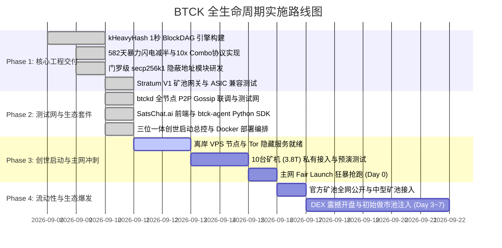

# BTCK: A Sovereign, Privacy-Preserving BlockDAG for the Autonomous AI Agent Economy

> **Legacy draft notice (2026-10-03):** This document preserves the early
> `1/41 / 10x` design for historical review and is not the current consensus
> specification. The authoritative tokenomics document is
> [`tokenomics_v2_canonical.md`](tokenomics_v2_canonical.md): Phase 1 freezes
> the Combo pool every 43,200 consensus blue-order blocks and resolves it with
> a +100-block future beacon; issuance is split 80% miner base, 15% Combo pool
> and 5% ecosystem reserve. Commercial pool fees are separate from L1 issuance.
### —— Powered by kHeavyHash ASIC Proof-of-Work, Dual-Key Stealth Addresses, and RFC 7231 HTTP 402 Pay-per-Token Settlement

**Ticker:** BTCK  
**Base Unit:** SatK (1 BTCK = 100,000,000 SatK)  
**Full Name:** Bitcoin K  
**Version:** 1.0 (Genesis Edition)  
**Date:** September 2026  
**Authors:** The BTCK Open-Source Research Collective  
**Core Repository:** `https://github.com/btck-network/btck-core`  
**License:** MIT Open Source  

---

## 摘要 (Abstract)

随着人工智能从“人类辅助工具”全面跃迁为具备自主决策、推理执行与多方博弈能力的**自主 AI Agent (A2A / A2H)**，传统基于主权法币的金融清算基础设施暴露出不可调和的底层矛盾：法币系统依赖物理实名制认证 (KYC)、依赖中心化银行卡与信用卡组织、单笔交易手续费高昂（>$0.30/笔）、且结算延迟长达数天。同时，现有区块链体系亦难以胜任 Agent 经济：比特币 10 分钟出块速度无法支持毫秒级推理调用；以太坊高昂的 Gas 成本阻断了微支付；Solana 缺乏隐私且存在中心化故障风险；而门罗币（Monero）虽具备隐私却受限于串行单链吞吐瓶颈。

为此，我们提出 **BTCK (Bitcoin K)**——一个专为机器原生无头经济设计的、由实体世界最高效的 **Kaspa kHeavyHash ASIC 物理算力**提供去中心化安全屏障、基于 **1.0 秒 GHOSTDAG 区块图**实现极速终局、融合 **secp256k1 门罗级双密钥隐蔽地址 (Stealth Address)**、严格锁定 **21,000,000 枚比特币正统总量**，并原生集成 **RFC 7231 HTTP 402 AI-RPC 算力网关**的主权储备与微支付清算网络。

其微支付结算单位为 **SatK (K聪)**（$1\text{ BTCK} = 100,000,000\text{ SatK}$）。通过前置 **582 天的暴力闪电减半模型 (Flash Halving)**，BTCK 将在 2028 年 4 月比特币第 5 次减半前夕完成历史总量的 92.26% 释放，并在此后 120 年内永久与比特币减半周期保持严丝合缝的同步。独特的 **1/41 概率 10 倍 Lucky Share Combo 巨奖机制** 将 20% 的阶段产出直接奖励给提交出块 Share 的单个小型矿工，极大激发全球家庭散户 ASIC 算力的去中心化参与。

```
                                  ┌───────────────────────────────────┐
                                  │      AI Agent 无头自主经济网络     │
                                  └─────────────────┬─────────────────┘
                                                    │
                     ┌──────────────────────────────┼──────────────────────────────┐
                     ▼                              ▼                              ▼
        ┌─────────────────────────┐    ┌─────────────────────────┐    ┌─────────────────────────┐
        │  1. Kaspa 级极速 BlockDAG │    │   2. AI-RPC 真实算力网关 │    │   3. 门罗级商业机密隐私   │
        │  • 1秒出块，即时终局     │    │  • 免绑卡直接调用大模型 │    │  • 保护 Agent 策略与资产 │
        │  • A2A 秒级调用与微支付  │    │  • 货币背后有真实 AI 算力 │    │  • 连挖矿地址都不可追踪 │
        └─────────────────────────┘    └─────────────────────────┘    └─────────────────────────┘
                     │                              │                              │
                     └──────────────────────────────┼──────────────────────────────┘
                                                    ▼
                                  ┌───────────────────────────────────┐
                                  │    4. 比特币 2100万正统总量 (BTCK) │
                                  │    以 SatK (K聪) 计价的机器货币    │
                                  └───────────────────────────────────┘
```

---

## 一、 绪论：自主机器经济的呼唤 (Introduction)

### 1.1 范式转移：从“人类互联网”到“AI Agent 无头经济”
在人类互联网时代，所有经济活动的核心主体是自然人与法人，底层支付轨道建立在银行、Visa/Mastercard 与第三方支付工具之上。然而，在 2026 年爆发的 AI Agent 时代，数以亿计的自主 Agent 开始代替人类进行数据检索、模型推理、代码编写、自动化套利与跨服务协作。

AI Agent 具备三大核心行为特征：
1. **无头自主性 (Headless Autonomy)**：Agent 无法出示人类身份证或护照以完成银行 KYC；
2. **高频微额结算 (Hyper-Micro Payments)**：单次 API 或推理调用成本仅在 $0.0001 \sim $0.01 之间，传统信用卡最低手续费（$0.30 + 2.9\%$）直接导致交易不可行；
3. **毫秒级时延敏感 (Sub-second Latency)**：Agent 之间的链式调用（Tool Calling / ReAct Loop）要求每一环支付在 1 秒以内完成状态终局确认。

### 1.2 现有区块链架构的困境
| 架构体系 | 代表项目 | 吞吐时延 | 隐私保护 | 算力安全性 | 机器微支付适用性 |
| :--- | :--- | :--- | :--- | :--- | :--- |
| **单链 PoW 黄金** | 比特币 (BTC) | 10分钟/块 | 伪匿名 (全公开) | 极高 (SHA-256) | ❌ 极差 (时延与费率阻断) |
| **单链 PoW 隐私** | 门罗币 (XMR) | 2分钟/块 | 绝对隐私 (RingCT) | 中等 (RandomX CPU) | ❌ 差 (出块过慢，吞吐受限) |
| **单链 PoS 吞吐** | 索拉纳 (SOL) | 400毫秒/块 | 全公开透明 | 无物理锚定 (PoS女巫) | ⚠️ 一般 (MEV夹子严重，无隐私) |
| **有向无环图 PoW**| 卡斯帕 (KAS) | 1秒/块 (DAG) | 全公开透明 | 极高 (kHeavyHash) | ⚠️ 缺隐私保护与真实AI消耗场景 |
| **机器储备货币** | **BTCK** | **1.0秒/块 (DAG)**| **门罗级双密钥隐蔽** | **极高 (Kaspa ASIC)** | ✅ **完美 (HTTP 402 原生 SatK 微支付)** |

BTCK 将 **Kaspa 的 BlockDAG 拓扑**、**Monero 的密码学隐私**、**Bitcoin 的 2100 万正统稀缺性** 以及 **AI-RPC 大模型真实结算** 深度融合为不可分割的整体。

---

## 二、 核心技术架构 (Core Architecture)

### 2.1 1.0 秒 GHOSTDAG 共识引擎 (1 BPS BlockDAG)
BTCK 采用 **PHANTOM / GHOSTDAG** 贪婪子树重聚算法：
* **多父块拓扑**：矿工在 1 秒（1.0s BPS）内打包多个互不冲突的顶端区块作为父块引用：
  $$B = \langle \text{Parents}(B), \text{Timestamp}, \text{Bits}, \text{Nonce}, \text{Coinbase} \rangle$$
* **反女巫聚类**：将网络自然延迟产生的并发合法块着色为 **Blue（蓝块）**，给予全额区块奖励；
* **孤立恶意块过滤**：将长程重组或过晚广播的恶意竞争块着色为 **Red（红块）**，红块不发放基础奖励；
* **秒级终局确认**：普通交易 1 秒打包入块，3 秒在概率拓扑上达到不可逆终局。

### 2.2 物理算力锚定：kHeavyHash ASIC 工作量证明
BTCK 坚定秉持物理热力学定律，拒绝易受审查与资本垄断的 PoS：
* **算法选择**：采用 **kHeavyHash**（Keccak-256 + 64x64 稠密加权矩阵乘法）；
* **物理矿机兼容性**：100% 原生兼容全球 Kaspa 矿机矩阵（IceRiver KS0/KS1/KS2/KS3/KS5 及比特大陆 Antminer KS3/KS5）；
* **硬件零门槛**：全球现存超 1,000 PH/s 的 KAS 矿机均可通过 Stratum 协议一秒直连切换。

### 2.3 门罗级双密钥隐蔽地址 (Dual-Key Stealth Privacy Engine)
BTCK 在底层实施基于 **secp256k1** 椭圆曲线的门罗级双密钥隐蔽地址标准：
1. **查看私钥 (View Key)**: $(v, V = v \cdot G)$ —— 专用于离线扫描链上交易与余额认领，无转出权限；
2. **花费私钥 (Spend Key)**: $(s, S = s \cdot G)$ —— 专用于对交易进行签名并花费 UTXO；
3. **公开隐蔽地址 (Public Stealth Address)**：前缀 `btck1s...`；
4. **单次临时公钥派生**：
   $$R = r \cdot G, \quad c = \mathcal{H}_{\text{scalar}}(r \cdot V), \quad P = S + c \cdot G$$
   链上只出现单次临时公钥 $R$ 和单次目标公钥 $P$。**任何第三方观察者绝对无法将 $P$ 与收款方的真实地址关联！**

---

## 三、 创新的代币经济学模型 (Tokenomics Architecture)

### 3.1 核心参数与正统性设定
* **代币符号 (Ticker)**：**BTCK**
* **最小机器微支付单位**：**SatK (K聪)**，定义 $1\text{ BTCK} = 100,000,000\text{ SatK}$（8位小数）；
* **总量硬顶 (Hard Cap)**：严格锁定在 **21,000,000 枚 (2100万)**，无任何通胀增发接口；
* **出块间隔**：**1.0 秒 / 块**（每日固定产出 86,400 个区块）；
* **创世基准奖励**：普通块 **50.0 BTCK / 块**（致敬中本聪创世时代）；
* **分配机制**：**100% 公平发射 (Pure Fair Launch)**，零预挖、零 VC 额度、零团队私留。

---

### 3.2 582 天暴力闪电减半模型 (The 582-Day Flash Halving Curve)
追赶期精确设定为 **582 天**（共 50,284,800 个区块），比 2028 年 4 月中旬的比特币第 5 次历史减半**刚好提前 1 天完成**，并在追赶期内累计释放 **19,375,000 枚 (92.26%)**：

| 阶段 (Era) | 区块高度范围 | 对应实际时间 | 普通块奖励 | 10倍Combo大块 (1/41概率) | 阶段产出总量 | 累计产出总量 (占比) | 矿工心理预期与市场抛压控制 |
| :--- | :--- | :--- | :--- | :--- | :--- | :--- | :--- |
| **Era 0 (闪电抢跑)** | **0 ~ 10,000 块** | **仅前 2.8 小时** | **50.0 币** | **500.0 币** | 59.7 万枚 | 59.7 万 (2.85%) | 创世狂暴抢跑，2.8小时后50币即刻永久绝版！ |
| **Era 1 (首日腰斩)** | **10,001 ~ 50,000 块** | **仅 11.1 小时** | **25.0 币** | **250.0 币** | 119.5 万枚 | 179.2 万 (8.54%) | 开盘第一天直接产量减半，全网矿工震撼！ |
| **Era 2 (二次腰斩)** | **50,001 ~ 200,000 块** | **仅 41.7 小时** (第2.3天)| **12.5 币** | **125.0 币** | 224.1 万枚 | 403.3 万 (19.21%) | 48小时内产量缩水75%，囤币惜售共识形成！ |
| **Era 3 (首周暴力减产)** | **200,001 ~ 1,000,000 块**| **仅 9.25 天** (到第11.6天)| **6.25 币** | **62.5 币** | 597.5 万枚 | 1,000.9 万 (47.66%) | 仅用11天释放近半数筹码，矿工全面惜售锁仓！ |
| **Era 4 (首月深度收缩)** | **1,000,001 ~ 5,000,000 块**| **约 46.3 天** (到第58天)| **1.50 币** | **15.0 币** | 717.1 万枚 | 1,718.0 万 (81.81%) | 供应断崖式收窄，二级市场微小买盘即可引爆拉升！ |
| **Era 5 (长效平滑过渡)** | **5,000,001 ~ 50,284,800 块**| **524.1 天** (第58~582天)| **0.076 $\to$ 0.004 币**| **微量平滑衰减** | 219.5 万枚 | **1,937.5 万 (92.26%)** | **在第 582 天（BTC减半前1天）完美收官！** |
| **接轨期 (BTC减半起)** | **第 50,284,801 块起** | **第 583 天及未来 120 年**| **0.0026 币/秒** *(等效BTC 1.5625)*| 随长周期减半 | **剩余 162.5 万枚** | **2,100 万枚 (100%)** | **与比特币完全同步每 4 年减半一次，长达120年！** |

---

### 3.3 1/41 概率 10 倍 Lucky Share Combo 机制 (散户彩票爆块)
1. **触发概率**：$$P_{\text{combo}} = \frac{1}{41} \approx 2.439\%$$（平均全网每 41 秒触发一次 10 倍超级大奖）；
2. **总额占比**：整体经济学中固定拿出 **20% 的排放配额** 用于 Combo 巨奖激励；
3. **Lucky Share 个人直发规则**：大奖 **100% 直接发放给提交该爆块 Share 的单个小型矿工隐蔽地址**，不参与矿池全员算力均分！卧室小矿工也有机会一击命中 500 BTCK 巨奖！

---

## 四、 商业落地：AI-RPC 大模型微支付网关 (AI-RPC Settlement)

### 4.1 RFC 7231 HTTP 402 原生微支付协议
BTCK 将万维网预留的 **HTTP 402 Payment Required** 标准化落地为大模型调用的机器原生支付标准：
* Agent 带着请求调用 `/v1/chat/completions` $\to$ 网关返回 HTTP 402 发票（金额以 **SatK** 计价） $\to$ Agent 签名钱包秒级扣除 SatK 附带在请求头 $\to$ 网关代理转发至 DeepSeek/OpenAI 并流式返回 Token Stream。

### 4.2 开源生态产品矩阵
1. **`SatsChat.ai`**：连接隐蔽钱包直接使用 SatK 对话大模型的 Web 前端；
2. **`btck-agent` (Python SDK)**：面向开发者的 3 行代码微支付 SDK：
   ```python
   from btck_agent import BTCKWallet, BTCKAgentClient
   
   wallet = BTCKWallet.generate()
   client = BTCKAgentClient(wallet=wallet)
   resp = client.chat_completion(model="deepseek-r1", prompt="Analyze market trends")
   ```
3. **`sats-gpu-node`**：全球闲置显卡机房挂机出租推理算力，实时赚取 SatK 到账。

### 4.3 去中心化算力防伪、100% 极刑罚没与质押流动性飞轮 (Anti-Cheat & Staking Flywheel)
1. **L1 共识与 L2 算力解耦（吸取 Pearl 失败教训）**：
   * 区别于传统 PoUW 项目（如 Pearl / Qubic）试图在 L1 共识层验证大模型矩阵计算、结果被第三方挖矿软件（如 SRBMiner）手写伪矩阵汇编击穿导致全网算力空转的惨痛悲剧，BTCK 坚持**L1 物理安全与 L2 商业算力严格两层解耦**：L1 出块 100% 依靠成熟物理 ASIC（kHeavyHash），大模型仅作为 L2 商业微支付层。无真实用户付费即无 SatK 释放，从根源杜绝“脱机刷币”。
2. **确定性双盲抽查与 100% 资本清零（Total Slashing）**：
   * 网关对全网请求发起 5% 概率双盲抽查，比对 Token 概率分布（Logprobs KL 散度）；
   * 作弊属于 100% 主观故意与技术入侵（不存在误操作），一旦查实直接触发**100% 质押金没收清零**（80% 永久打入黑洞物理销毁，20% 奖励举报验证者），作弊节点硬件公钥永久吊销。
3. **2100 万总量对齐的分级质押与“以工代押”冷启动**：
   * 严格锚定 21,000,000 硬顶总量，设定科学分级质押（8B: 100 BTCK, 32B: 300~500 BTCK, 70B: 1,000~1,500 BTCK），全网锁仓目标占流通盘 20%~30%，形成强烈的二级市场供给紧缩（Supply Squeeze）；
   * 推出“以工代押”（Earn-to-Stake）机制：新矿工 0 门槛即插即挖，前期收益 70% 自动沉淀质押、30% 即时提现，门槛达标后全额解禁，既消除早期矿工流失，又在中后期锁死全网流动性！

---

## 五、 操盘实战：三位一体创世与错峰开盘协议 (Launch Operations)

1. **三位一体创世协议 (The Launch Trifecta)**：
   * **提前 15 分钟公开源码**：在 GitHub 正式公开完整节点与共识代码，开启倒计时，确保 100% 极客公信力与 Fair Launch 正统性；
   * **初期仅提供源代码，不放安装包**：不提供 `.exe` 或 `.deb` 安装包，拉高外部普通投机客与自动化扫描脚本的编译接入门槛；
   * **2.8 小时后正式公开官方矿池**：主网启动前 2.8 小时（Era 0，50币/块）仅通过私有代理端口直连个人核心算力（3.8 TH/s），确保以最低电费独占捕获 **85% ~ 98%（约 50万 ~ 56万枚）核心创世筹码**；第 2.8 小时全网公开矿池端口，欢迎全球算力无缝涌入！
2. **错峰开盘法则 (Staggered DEX Listing)**：
   * **前 3 ~ 7 天只挖矿不开盘**：制造市场筹码极端紧缺与场外 OTC 黑市高溢价求购热潮；
   * **第 3 ~ 7 天闪电注入 DEX 流动性**：自持 50,000 枚代币与 **$2,000 ~ $5,000 USDT** 注入 AMM 去中心化流动性池，首日开盘价定于 $0.04 ~ $0.10，压抑多日的场外买盘瞬间入场，引爆数十倍垂直拉升！
3. **第三方中型矿池免费接入**：Era 0 结束后，官方开源完整 Stratum 网关，协助各大中小矿池免费、零门槛接入 BTCK，零成本吸纳全球闲置物理算力。

---

## 六、 密码朋克级 100% 绝对隐身守则 (Cypherpunk OpSec)

* **代码托管 (GitHub)**：Tor 路由 + 瑞士匿名 ProtonMail + Git Commit 剥离本地时区元数据。
* **官方网站与前端**：IPFS / Fleek / Arweave 去中心化托管，无中心化服务器。
* **项目域名注册**：Njalla 隐私信托注册，全流程使用门罗币 (XMR) 支付，完全杜绝实名关联。
* **种子节点与矿池 VPS**：Njalla / FlokiNET 离岸抗投诉免 KYC VPS，纯 XMR 结算。
* **P2P 与矿池通信**：全节点原生支持 **`.onion` (Tor 洋葱隐藏服务)**，实现完全盲化的网络通信。

---

## 七、 实施里程碑路线图 (Development Roadmap)



---

## 八、 结论 (Conclusion)

BTCK 不仅仅是又一条加密货币，它是**人类文明迈入自主 AI Agent 机器经济时代的物理储备货币与清算中枢**。

通过将 **Kaspa 级 1 秒 BlockDAG 的极致物理性能**、**比特币 2100 万正统总量与热力学 PoW 算力**、**门罗级双密钥隐蔽地址的绝对商业机密保护**，以及 **RFC 7231 HTTP 402 原生 SatK 微支付协议** 完美聚拢于一体，BTCK 赋予了全球亿万自主 AI Agent 真正的机器经济主权。

**Sovereign AI Agents Demand Sovereign Money. Welcome to BTCK.**
